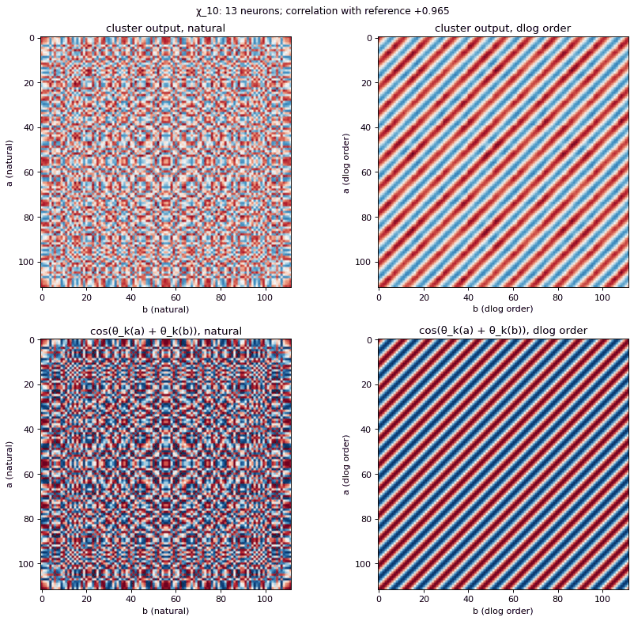

# crypto-interp

Mechanistic interpretability of number-theoretic algorithms learned by small
transformers.

We train one-layer transformers on modular arithmetic (multiplication,
addition, and square roots of products mod a prime *p*) and reverse-engineer what they learn.
The question is whether networks converge on the algorithms number theory
already knows, find variants of them, or invent something else.

For multiplication mod *p* the answer so far is a learned version of a
classical idea. The network takes discrete logarithms implicitly, so that
multiplication becomes addition of angles. Each MLP neuron cluster then
computes one character χ_k(ab) = χ_k(a)·χ_k(b) of the multiplicative group,
and the readout combines a few characters, much as the Chinese remainder
theorem combines residues, to single out the answer.

<p align="center">
  
</p>

*The 13 neurons of one cluster in the reference model. Their output over all
(a, b) looks like noise in natural order and becomes cos(θ₁₀(a) + θ₁₀(b)) once
inputs are sorted by discrete log (correlation 0.965). Reproduce it with
`crypto-interp figure cluster --run tests/fixtures/mul_p113_d24_m32_seed1 --k 10 --out cluster.png`.*

## Install

```bash no-run
git clone https://github.com/Praz314159/crypto-interp && cd crypto-interp
pip install -e .            # Python ≥ 3.10; CPU is enough for everything but training sweeps
```

## Try it

The repository includes a trained model, `tests/fixtures/mul_p113_d24_m32_seed1`
(multiplication mod 113, `d_model=24`, `d_mlp=32`). Nothing needs training:

```bash
crypto-interp measure kernel_noise --run tests/fixtures/mul_p113_d24_m32_seed1
crypto-interp measure helpers --run tests/fixtures/mul_p113_d24_m32_seed1
crypto-interp figure walkthrough --run tests/fixtures/mul_p113_d24_m32_seed1 --a 7 --b 12 --out walkthrough.png
```

The model uses the characters K = (3, 10, 20, 51). χ20 has no neurons of its
own: it is a *helper*, the second harmonic that the χ10 neurons produce
through the ReLU. The [quickstart](docs/quickstart.md) walks through what each
number means.

## Documentation

- [Quickstart](docs/quickstart.md): the reference model from the command line and from Python.
- [Tutorial](docs/tutorial.md): train a model, measure a population of runs, write your own measure.
- [Measures](docs/measures.md): every measure, what it computes, and its fields.
- [Library](docs/library.md): how the package is layered, the on-disk run format, and the interpretability primitives.

## Layout

```text
crypto_interp/
  data/        tasks (mul, add, sqrt_of_product) as datasets, built from a TaskSpec
  models/      the one-layer transformer, with hook points
  reference/   textbook algorithms (Tonelli–Shanks, Cipolla) for labels and comparison
  training/    the training loop and ExperimentConfig
  runs/        checkpoints, manifests, and the run index (query runs by config)
  interp/      primitives: character bases, activation caches, hooks, ablations, Session
  measures/    named, versioned, cached analyses → pandas tables
  figures/     plots drawn from measure tables
  viz/         a picture of one forward pass
  theory/      closed-form results the measures are compared against
  cli/         the crypto-interp command
experiments/<id>_<name>/config.py   one experiment's base config; its runs/ are not in git
infra/runpod/                       training sweeps on a rented GPU
tests/                              unit tests, and the reference model in tests/fixtures/
```

## Citing

See [`CITATION.cff`](CITATION.cff). The code is MIT-licensed ([`LICENSE`](LICENSE)).
